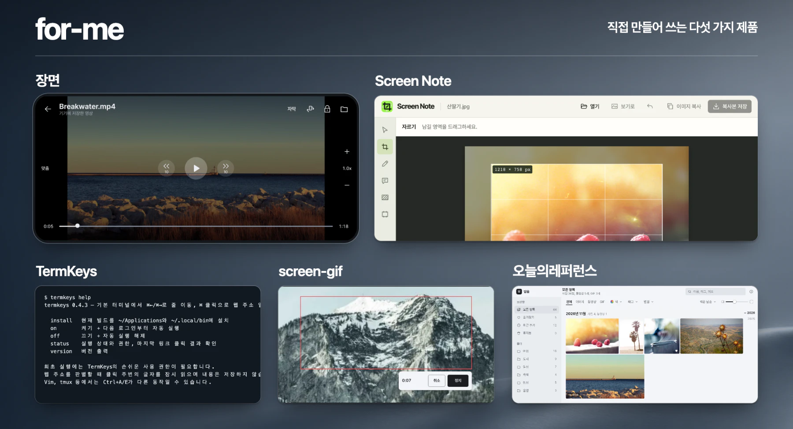

# for-me



## 목적

평소 사용하는 앱을 직접 만들고, 쓰고, 유지보수하는 개인 프로젝트입니다.

음악 앱과 동영상 앱처럼 일상에서 쓰는 앱이 대상입니다. 특히 광고가 붙은 앱 중 직접 대체할 수 있는 것을 후보로 삼습니다.

## 앱

앱마다 `apps/<앱>/` 폴더에 문서, 코드와 빌드 설정을 둡니다. 앱마다 언어와 빌드 도구가 다를 수 있어 저장소 루트에는 어느 앱의 빌드 파일도 두지 않습니다.

| 앱 | 폴더 | 대상 | 상태 |
|---|---|---|---|
| [장면(동영상 앱)](apps/video/README.md) | `apps/video` | Android, 이후 Windows와 macOS | 개발 중. 홈과 보관함, 터치 재생과 화면 잠금 구현. 실제 기기 재생은 미검증 |
| [screen-gif](apps/screen-gif/README.md) | `apps/screen-gif` | Windows, 이후 macOS | 화면의 일부를 녹화해 GIF로 저장. Windows 시제품에서 영역 녹화와 저장 확인 |
| [TermKeys](apps/termkeys/README.md) | `apps/termkeys` | macOS | 개발 중. 0.2.1에서 보안 입력 중 줄 이동 확인. 메뉴 입력 제외와 실제 응답 지연 조건은 미검증 |
| [Screen Note](apps/screen-note/README.md) | `apps/screen-note` | macOS, Windows | 이미지를 보기 모드로 열고 GIF를 재생. 정지 이미지에 메모하거나 자른 뒤 복사본 저장 |
| [사용과 개발 기록](apps/journal/README.md) | `apps/journal` | 로컬 웹과 개발 AI | 요청, 사용 경험, 변경, 검증과 버전을 연결. 개인 기록은 로컬 파일에 보관 |
| [오늘의레퍼런스](apps/today-ref/README.md) | `apps/today-ref` | 로컬 웹과 개발 AI | 개발 중. 갤러리와 템플릿 구현. 대시보드 웹과 숙소 예약 웹 등 완성작을 갤러리에서 확인 가능. 사용자의 실제 사용 전 |

폐기한 도구는 폴더를 지우고 기록만 남깁니다. 이미지 생성으로 UI 레퍼런스를 만들던 Viewgrain은 2026-11-18에 폐기했고 이유는 [폐기 기록](docs/retired-viewgrain.md)에 있습니다.

## 사용과 변화 기록

개발 AI는 사용자 요청과 작업 결과를 [기록 절차](apps/journal/docs/agent.md)에 따라 남깁니다. 웹에서는 시작 이유, 사용 경험, 변경 이력과 버전별 확인 범위를 봅니다. 직접 입력도 가능합니다.

```sh
node apps/journal/src/server.mjs
```

실행 후 `http://127.0.0.1:4318`을 엽니다. 별도 패키지 설치는 필요하지 않습니다. 기록 보존과 백업 방법은 [사용법](apps/journal/README.md)에 있습니다.

## 개발

모든 앱에 공통인 절차와 규칙입니다. 앱별 개발 환경, 검사 명령과 기록은 각 앱의 README에 있습니다.

- [개발 절차](docs/development.md): 저장소 구성, 앱 추가 방법, Windows와 macOS 공통 규칙, [빌드와 설치본 점검](docs/development.md#빌드와-설치본-점검)(`node scripts/build-status.mjs`)
- [QA 절차](docs/qa.md)
- [작업 규칙](AGENTS.md)
- [Git 규칙](.docs/git-convention.md)

## 제외 대상

쿠팡플레이와 유튜브처럼 콘텐츠를 직접 확보할 수 없어 대체하기 어려운 서비스는 제외합니다.
