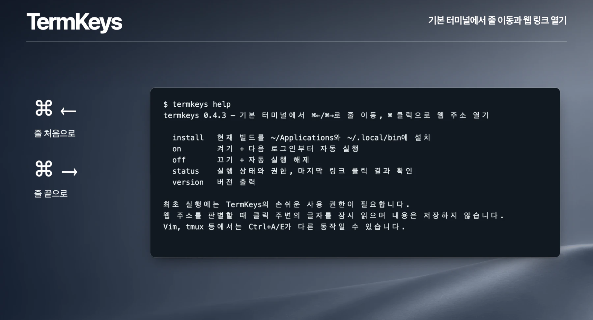

# TermKeys



macOS 기본 터미널에서 `⌘ + 클릭`으로 웹 링크를 열고, `⌘ + ←/→`로 입력 줄의 처음과 끝으로 이동합니다. 메뉴 막대와 Dock 아이콘 없이 실행하며 터미널 명령어로 제어합니다.

0.4.0에서는 링크 이름을 클릭하면 macOS의 손쉬운 사용 기능이 그 위치에 제공하는 웹 주소를 먼저 확인합니다. 0.4.0에서는 목적지가 없는 일반 텍스트의 주소를 한 줄에 따로 표시해야 했습니다. 앞뒤 공백은 허용하며 `http://`, `https://`, `www.`로 시작하는 주소를 지원합니다. 주소 안의 한글과 괄호는 보존합니다. 드래그와 더블 클릭은 터미널이 처리합니다.

**수정 이유** 사용자는 문장 속 주소에 `까지만`이 붙어 있을 때 TermKeys 한 번 클릭과 Mac 기본 터미널의 `⌘ + 더블 클릭` 모두 조사까지 포함한 주소를 여는 현상을 확인했습니다. 한글은 실제 웹 주소에도 들어갈 수 있어 글자만으로 경계를 확정할 수 없습니다. 링크 정보를 전달할 수 없는 환경에서는 주소를 한 줄에 따로 적거나, 0.4.3부터 문장 안에서 아래와 같이 괄호로 감쌉니다.

macOS 27.2.1의 기본 터미널 2.15와 TermKeys 0.4.0에서 사용자가 확인한 방식은 웹 주소를 한 줄에 단독으로 표시하고 Command 한 번 클릭하는 것입니다. Codex가 표시한 링크 이름과 셸이 직접 출력한 링크 이름은 이 환경에서 열리지 않았습니다.

0.4.1부터는 제목 다음 줄에 `(https://example.com/guide#section)`만 표시된 경우에도 괄호 안의 주소를 클릭할 수 있습니다. 주소 안의 괄호와 `#section`은 보존합니다. 이 판별은 터미널이 제공한 텍스트의 줄바꿈을 기준으로 합니다.

0.4.2에서는 클릭 중 포인터가 시작점에서 2포인트 이내로 움직여도 누른 곳과 놓은 곳이 같은 웹 주소이면 열기를 요청합니다. 그보다 멀리 끌었다가 시작점으로 돌아오면 드래그로 처리합니다.

0.4.3부터는 `MDN 지문 (https://example.org/guide#section)을 다시 보세요.`에서도 괄호 안의 주소를 열 수 있습니다. 여는 괄호는 줄 시작이나 공백 다음에 둡니다. 주소 안에서 짝이 맞는 괄호와 한글 경로는 그대로 전달합니다.

링크가 열리지 않으면 `termkeys status`의 **마지막 ⌘ 클릭**을 확인하세요. 클릭 취소, 주소 확인 실패, macOS의 열기 요청 수락 여부를 구분합니다. 현재 실행에서 받은 가장 최근 결과 하나만 상태 파일에 남깁니다. 주소, 터미널 본문, 포인터 위치와 클릭 시각은 기록하지 않습니다.

지원 목표는 macOS 13 이상입니다. 현재 검증 범위는 [검증 기록](docs/verification.md)에 있습니다. 일반 명령어 입력을 대상으로 하며, Vim과 tmux 등에서 같은 동작을 보장하지 않습니다.

## 빌드와 검사

자동 검사는 단축키 등록, 클릭과 드래그의 구분, 웹 주소 판별, 접근성 조회 실패를 다룹니다. macOS의 테스트 프로세스 조회를 제한하는 샌드박스에서는 일반 사용자 세션에서 실행해야 할 수 있습니다.

macOS의 Xcode Command Line Tools와 Swift를 사용합니다. 외부 패키지는 없습니다. 이 폴더에서 실행합니다.

```sh
bash scripts/test.sh
bash scripts/build.sh
```

생성물은 `build/TermKeys.app`입니다. 빌드는 현재 Mac의 아키텍처를 사용하며 로컬 실행용 임시 서명을 합니다. 공증이나 외부 배포는 하지 않습니다.

## 설치와 실행

```sh
build/TermKeys.app/Contents/MacOS/termkeys install
~/.local/bin/termkeys on
~/.local/bin/termkeys status
~/.local/bin/termkeys off
```

`~/.local/bin`이 PATH에 있으면 `termkeys`만 입력하면 됩니다. PATH는 셸이 명령어를 찾는 폴더 목록입니다. 앱은 `.zshrc`와 터미널 설정을 수정하지 않습니다. 현재 창에서만 명령어 경로를 추가하려면 `export PATH="$HOME/.local/bin:$PATH"`를 실행합니다.

- `on`: 지금 실행하고 다음 로그인부터 자동 실행합니다. 반복 실행해도 앱을 중복 실행하지 않습니다.
- `off`: 현재 실행을 멈추고 다음 로그인부터도 실행하지 않습니다. 앱과 설정 파일은 보존합니다.
- `status`: 꺼짐, 상태 미확인, 권한 대기, 터미널 또는 입력 영역 대기, 단축키 등록 완료와 등록 실패를 구분합니다. 보안 입력 상태, 단축키 통지 횟수와 이동 키 전송 요청 횟수도 표시합니다. 전송 요청은 실제 이동 성공 횟수가 아닙니다.

처음 `on`을 실행하면 시스템 설정의 **개인정보 보호 및 보안 → 손쉬운 사용**에서 **TermKeys**를 허용해야 합니다. 목록에 없으면 아래 앱을 직접 추가합니다.

```text
~/Applications/TermKeys.app
```

권한 허용 후 잠시 기다려 `status`를 확인합니다. 계속 대기 상태라면 `off` 후 `on`을 실행합니다. 업데이트 후 재시작해도 권한 대기가 계속되면 손쉬운 사용 목록의 기존 TermKeys 항목을 제거하고 `~/Applications/TermKeys.app`을 다시 추가해 허용합니다. 이번 0.2.0과 0.2.1 업데이트에서는 이 절차 후 권한이 반영됐습니다. 사용자 승인을 프로그램이 대신 처리하지 않습니다. 로그인 항목 설정에서 백그라운드 실행을 차단한 경우에도 별도 허용이 필요할 수 있습니다.

## 동작 범위

- 기본 터미널이 앞에 있고 접근성 정보로 입력 영역과 일반 창을 확인한 경우에만 변환합니다. 확인 실패 시 원래 입력을 통과시킵니다.
- 다른 앱, 터미널의 검색 입력칸, Shift와 Option 및 Control이 추가된 조합은 변환 대상이 아닙니다.
- 보안 키보드 입력이 켜져 있어도 두 단축키의 등록과 이동 요청을 수행합니다. 보안 설정을 자동으로 끄지 않습니다. 실제 확인한 환경과 결과는 검증 기록에 구분합니다.
- `Ctrl + A/E`의 의미는 실행 중인 셸이나 프로그램이 정합니다. 줄바꿈과 화면 너비로 접힌 줄의 이동도 셸 동작을 따릅니다.
- 줄 이동은 터미널 본문을 읽지 않습니다. 웹 링크를 열 때 클릭한 요소나 글자의 링크 정보를 확인합니다. 글자로 표시된 주소의 범위를 판단할 때만 클릭 주변 글자를 잠시 읽습니다. 처음에는 양쪽 최대 32단위(UTF-16)에서 시작해 필요한 쪽만 최대 2,048단위까지 넓힙니다. 괄호로 감싼 주소는 범위 안에서 짝을 확인하고, 괄호 없는 주소는 줄의 양 끝을 확인해 단독 주소일 때 엽니다. 읽은 내용과 주소는 파일이나 로그에 저장하지 않습니다.
- 앱 전환과 입력 초점 변경 알림으로 단축키 등록을 해제하며 0.25초 간격으로도 확인합니다. 초점 변경과 단축키 통지가 겹치면 등록을 해제하고 원래 Command 방향키를 현재 앱에 되돌려 보내도록 구현했습니다. 빠른 전환에서 원래 입력이 유지되는지는 실제 검사가 필요합니다.

## 설치 위치와 업데이트

- 앱: `~/Applications/TermKeys.app`
- 명령어 연결: `~/.local/bin/termkeys`
- 자동 실행: `~/Library/LaunchAgents/dev.for-me.termkeys.plist`
- 실행 상태와 잠금: `~/Library/Application Support/TermKeys/`

업데이트 전 `termkeys off`를 실행하고 새 빌드에서 `install`을 실행합니다. 기존 앱은 검색에 중복으로 표시되지 않도록 `~/Library/Application Support/TermKeys/backups.noindex/`에 `.app-backup`으로 보관합니다. 이전 빌드가 필요하면 백업 하나를 다른 폴더에 `TermKeys.app`이라는 이름으로 복사한 뒤 그 복사본의 설치 명령을 실행할 수 있습니다. 같은 위치의 다른 앱이나 명령어는 덮어쓰지 않습니다. 임시 서명으로 빌드하므로 업데이트 후 손쉬운 사용 권한을 다시 허용해야 할 수 있습니다.

제거할 때는 먼저 `termkeys off`를 실행하고 위 앱, 명령어 연결, 자동 실행 파일, 상태 폴더를 Finder로 휴지통에 옮깁니다. 손쉬운 사용 목록에서도 TermKeys를 제거할 수 있습니다.

## 문서

- [범위](docs/scope.md)
- [기술 조사](docs/research.md)
- [실제 동작 검사](docs/qa.md)
- [검증 기록](docs/verification.md)
- [QA 이슈](docs/qa-issues.md)
