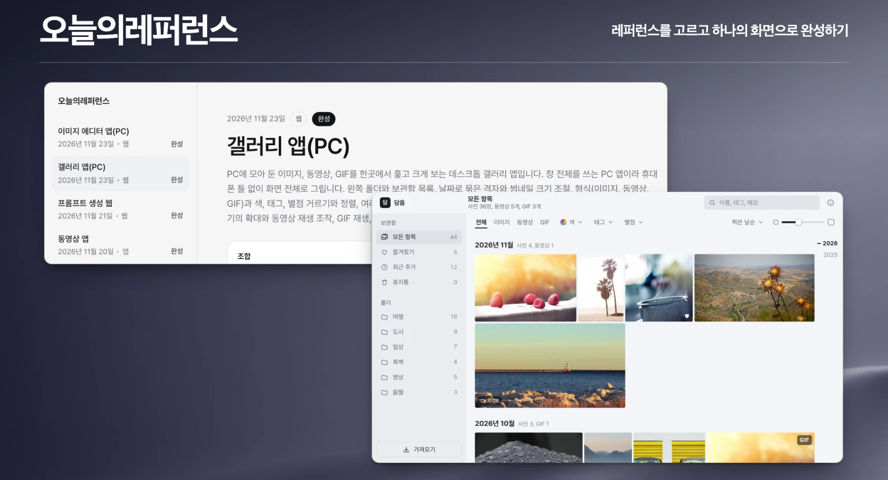

# 오늘의레퍼런스



매일 웹이나 앱 주제 하나를 정해 실제 운영 중인 제품과 레퍼런스 사이트의 화면을 모으고, 레퍼런스를 하나로 따르거나 조합해 UI/UX 중심의 웹 또는 앱을 만드는 도구입니다. 대화에서 "오늘의 레퍼런스"라고 말하면 개발 AI가 [진행 절차](docs/agent.md)에 따라 주제 정하기부터 고르기, 만들기, 1차 피드백, tastepin 다듬기까지 스스로 판단해 끝내고 결과를 보고합니다. 다른 화면을 만들 때 "오늘의 레퍼런스 대시보드 참고해서"처럼 말하면 [활용 절차](docs/use.md)로 완성작을 가져다 씁니다.

스킬로 부를 때는 `/today-ref-use <할 일> <대상>`처럼 첫 단어로 할 일을 정합니다. 예: `/today-ref-use 제작 정산 대시보드`, `/today-ref-use 수집 삭제 동작`, `/today-ref-use 개선 보관함`. 할 일 열 가지는 [호출 표](docs/invoke.md)에 있습니다.

## 실행

Node.js 24 이상과 pnpm을 사용합니다. 버전은 이 폴더의 `.node-version`과 `package.json`의 `packageManager`가 정합니다. 이 폴더에서 실행합니다.

```sh
pnpm install
pnpm gallery
```

갤러리는 `http://localhost:4319`에서 열립니다. 이 사본의 갤러리가 이미 떠 있으면 `pnpm gallery`는 새로 띄우지 않고 주소만 알리며, 다른 사본의 갤러리나 다른 프로그램이 그 포트를 쓰면 알리고 멈춥니다. 기본 흐름에서는 AI가 레퍼런스를 비교해 고르고 바로 제작을 시작합니다. 갤러리에서 AI가 고른 레퍼런스와 각각 어디를 참고했는지 살펴볼 수 있습니다.

직접 고르고 싶다면 주제가 **선택 대기**일 때 카드에서 하나 이상을 고른 뒤 **선택 문장 복사**를 눌러 대화창에 붙여 넣으세요. 여러 개를 고르면 각각 가져올 부분을 적거나 비워 두고 제안을 받을 수 있습니다. **제작 중**이나 **완성** 상태에서는 갤러리에 확정한 선택이 표시됩니다. 바꾸고 싶다면 대화에서 주제와 레퍼런스 번호를 알려 주세요.

**수집 완료**는 화면이 아니라 한 동작(삭제, 수량 입력 등)의 근거만 모은 주제입니다. 완성작이 없고, 카드마다 어떻게 확인했는지(조작해 확인, 정지 화면, 본문만 읽음, 2차 자료)와 어느 동작의 근거인지가 표시됩니다.

완성작은 주제마다 독립된 프로젝트입니다.

```sh
pnpm --filter work-<주제 id> dev
```

| 완성작 | 주제 |
|---|---|
| [대시보드 웹](works/2026-11-18-dashboard/README.md) | 웹 분석 대시보드 "소담책방" |
| [숙소 예약 웹](works/2026-11-18-stay/README.md) | 숙소 예약 사이트 "머물곳" |
| [가계부 앱](works/2026-11-18-budget/README.md) | 가계부 앱 "살림장" |
| [블로그 웹](works/2026-11-18-blog/README.md) | 개인 블로그 "오후의 서랍" |
| [동영상 앱](works/2026-11-20-video/README.md) | 저장한 영상을 OTT처럼 보는 재생기 "필름함" |
| [AI 채팅 앱](works/2026-11-20-ai-chat/README.md) | 출처와 작업 단계를 보여 주는 AI 채팅 "곁" |
| [프롬프트 생성 웹](works/2026-11-21-prompt/README.md) | 채팅이나 이미지와 채팅으로 프롬프트를 만드는 "말틀" |
| [갤러리 앱(PC)](works/2026-11-23-gallery/README.md) | 이미지, 동영상, GIF를 모아 보는 PC 갤러리 "담음" |
| [이미지 에디터 앱(PC)](works/2026-11-23-image-editor/README.md) | 자르기, 조정, 필터, 표시를 하는 PC 편집기 "손질" |
| [SNS 웹](works/2026-11-24-sns/README.md) | 피드, 글쓰기, 답글 줄기, 프로필과 알림이 있는 세 단 SNS "울림" |
| [음악 플레이어 앱](works/2026-11-28-music/README.md) | 미니 플레이어, 재생 화면, 대기열과 가사가 있는 음악 앱 "속지" |
| [게임 상점 웹](works/2026-11-28-game-shop/README.md) | 피처드 묶음, 오늘의 상품, 선수 팩, 구매 확인과 팩 개봉이 있는 축구 게임 상점 "하프라인 27". 2026-11-18 인게임 샵을 폐기하고 수집 자료로 다시 만듦 |
| [운영 설정 콘솔 웹](works/2026-11-28-config-console/README.md) | 설정 목록과 묶음 작업, 값 종류별 편집과 JSON 검증, 환경 비교와 게시, 게시 실패와 다시 시도가 있는 "노브". 프런트엔드 앱 후보 아홉 수집으로 만듦 |
| [갤러리 앱](works/2026-11-28-gallery-app/README.md) | 날짜 묶음 보관함과 연월일 전환, 추억, 끌어 닫는 사진 보기, 여러 장 선택과 앨범이 있는 휴대폰 갤러리 "낱장" |

대시보드 웹과 숙소 예약 웹은 2026-11-18에 AI가 사용자 역할로 만든 시험 결과입니다. 가계부 앱부터는 AI가 고르고 1차 피드백까지 하는 기본 절차로 만들었습니다.

## 폴더

| 경로 | 내용 | Git |
|---|---|---|
| `topics/<주제 id>/topic.json` | 주제, 레퍼런스 링크와 볼 점, 확정한 선택, 상태 | 포함 |
| `~/dev/p/today-ref-captures/<주제 id>/` | 레퍼런스 화면 캡처 | for-me 밖의 비공개 저장소. 아래 "캡처 저장소" |
| `works/<주제 id>/` | 완성작 프로젝트 | 포함 |
| `gallery/` | 레퍼런스를 보고 고르는 로컬 웹 | 포함 |
| `template/` | 완성작의 시작 프로젝트(React 19, Vite, TypeScript, motion, Tailwind) | 포함 |
| `topic.ts` | 주제 파일 형식과 검사. 갤러리와 검사 명령이 함께 씁니다 | 포함 |

## 캡처 저장소

캡처는 남의 제품 화면이라 공개 저장소인 for-me에 넣지 않습니다. 대신 비공개 저장소 `today-ref-captures`를 for-me와 같은 폴더(`~/dev/p`)에 받아 컴퓨터끼리 나눕니다(2026-11-27). 검사와 갤러리가 읽는 위치는 [scripts/captures.ts](scripts/captures.ts) 한 곳에서 정합니다.

1. 환경 변수 `TODAY_REF_CAPTURES`가 있으면 그 경로
2. 없으면 `~/dev/p/today-ref-captures`
3. 그 저장소도 없으면 예전처럼 `apps/today-ref/captures/`(Git 제외)

`pnpm check`의 마지막 줄에 어느 캡처 폴더를 읽었는지 나옵니다. 캡처가 없는 레퍼런스는 경고로 나오고, 갤러리는 캡처 대신 원본 링크를 보여 줍니다.

처음 쓰는 컴퓨터에서는 저장소를 받습니다. 그 컴퓨터의 `apps/today-ref/captures/`에 예전 캡처가 남아 있으면 같은 이름의 주제 폴더가 저장소에 없는지 확인하고 옮긴 뒤, 비어 있는 `captures/`를 지웁니다.

```sh
cd ~/dev/p
git clone https://github.com/joseph0926/today-ref-captures.git
```

수집하는 컴퓨터에서는 시작 전에 받고(`git -C ~/dev/p/today-ref-captures pull`), 수집을 마치면 그 주제 폴더를 커밋해 올립니다. 캡처는 한 번 저장하면 고치지 않으므로, 컴퓨터마다 다른 주제를 모으면 충돌이 나지 않습니다.

## 검사

```sh
pnpm test
pnpm check
pnpm typecheck
pnpm build
```

- `test`: 주제 파일 형식과 검사 명령의 자동 검사
- `check`: 실제 `topics/`의 형식, 캡처 파일의 이미지 형식과 크기, 확정한 주제의 완성작 폴더, tastepin 다듬기 전달 기록이 없는 완성작(경고. 취향 원장이 있는 머신에서만). `--topic <주제 id>`를 붙이면 그 주제만 봅니다. 같은 사본에서 다른 세션이 주제를 만드는 중이면 이렇게 씁니다
- `build`: 갤러리, 템플릿과 완성작 전체의 타입 검사와 빌드

검사 결과는 [검증 기록](docs/verification.md)에, 발견한 결함과 수정 후 재검증 결과는 [QA 이슈](docs/qa-issues.md)에 남깁니다.
