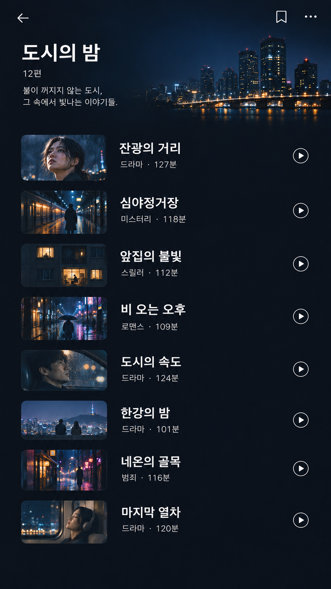

# FRAME 도시의 밤 컬렉션

두 번째 레퍼런스 묶음에서 처음 선택한 화면이다. 식별자는 `frame-002`, 버전은 `1`이며 2026-11-17에 등록했다. 이 버전에는 목록형 컬렉션 상세 화면 한 장만 포함한다.

## 선택한 화면

- 레퍼런스 식별자: `frame-002-collection-list`
- 화면: 도시의 밤 컬렉션 상세, 세로 목록형
- 원본: [collection-list.png](collection-list.png)
- 파일 정보와 선택 상태: [manifest.json](manifest.json)
- 생성 및 수정 요청: [prompts.md](prompts.md)

## 사용자 선택

사용자는 두 열 컬렉션의 디자인은 좋지만 한 작품이 한 줄을 쓰는 방식도 검토하자고 했다. 목록형 첫 결과에 다음 추가 프롬프트를 사용했다고 보고했다.

> 썸네일 너비가 너무 넓고 각 회차간의 간격이 너무 좁습니다

수정 전후 두 이미지를 비교한 뒤 사용자는 `2번으로`라고 선택했다. 이번 등록은 그 두 번째 이미지에 한정한다. FRAME 홈은 개선됐다는 평가를 받았지만 최종 선택에는 포함하지 않았고, 재생 화면도 아직 등록하지 않았다.

## 보존할 특징

아래는 선택한 화면에서 에이전트가 정리한 관찰이다.

- 한 작품이 한 행을 차지하고 왼쪽 썸네일, 가운데 제목과 정보, 오른쪽 재생 동작으로 정렬된다.
- 첫 목록형보다 썸네일이 좁아져 작품 제목을 읽을 공간과 이미지의 비중이 균형을 이룬다.
- 이미지 밖에 제목과 정보를 두고 카드 바탕을 반복하지 않는다.
- 어두운 배경과 단정한 글자, 차분한 보조 정보로 홈과의 시각적 관계를 유지한다.

두 목록형 모두 화면에 작품 여덟 개가 보인다. 항목 수를 줄인 결과나 행 간격의 수치 검증으로 해석하지 않는다. 보기 전환 기능의 도입도 이 선택으로 확정하지 않는다.

## 보관과 검증 범위

사용자가 제공한 PNG를 변환 없이 복사했다. 원본 파일명, 크기와 SHA-256은 메타데이터에 기록했다. 실제 생성 모델과 설정, 비용 및 전체 입력 전문은 미확인이다. P07 추가 문장만 사용자 보고로 확인했다.

사용자의 시각적 선택은 확인했다. 실제 기기의 가독성, 재생 동작, 접근성과 MCP 전달은 미검증이다. 이후 화면을 추가하거나 교체할 때는 이 버전을 보존하고 새 버전으로 등록한다.

[레퍼런스 목록](../../README.md)
