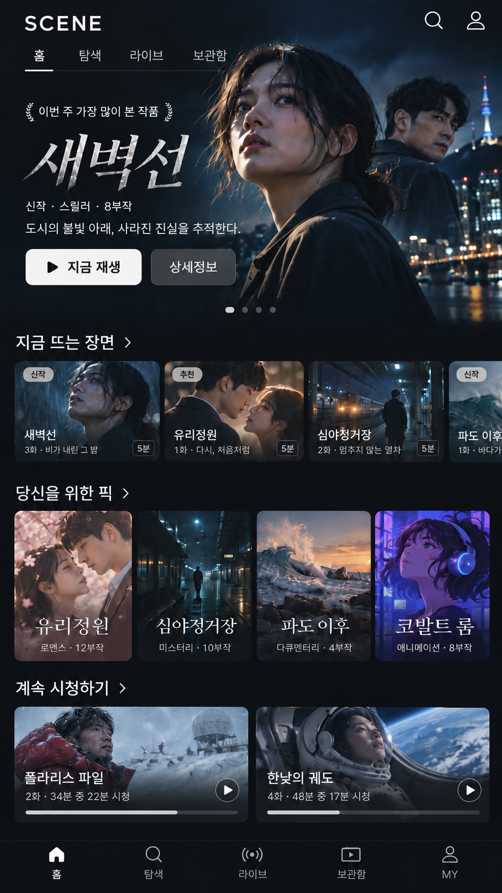
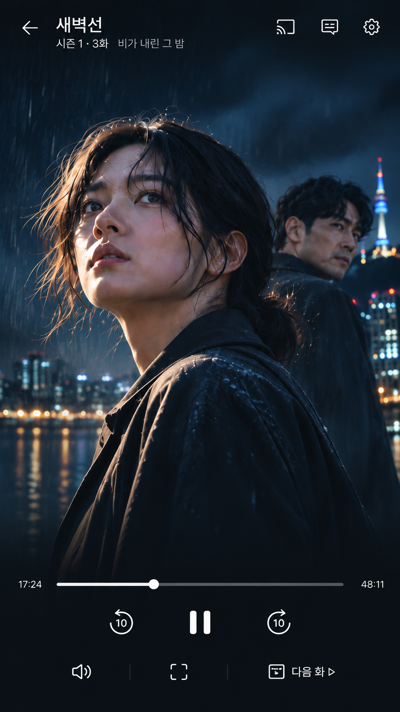
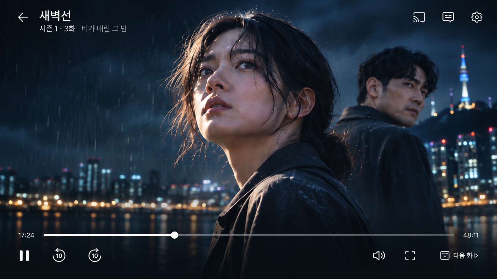

# SCENE 비디오 앱 레퍼런스

첫 번째 사용자 선택 묶음이다. 식별자는 `scene-001`, 버전은 `1`이며 2026-11-17에 등록했다. SCENE은 생성 이미지 안의 앱 이름이고 Viewgrain의 이름을 바꾼 것이 아니다.

## 선택한 화면

| 화면 | 이미지 | 크기 | 레퍼런스 식별자 |
|---|---|---|---|
| 홈 | [home.png](home.png) | 941 × 1672픽셀 | `scene-001-home` |
| 세로 재생 | [player-portrait.png](player-portrait.png) | 941 × 1672픽셀 | `scene-001-player-portrait` |
| 가로 재생 | [player-landscape.png](player-landscape.png) | 1672 × 941픽셀 | `scene-001-player-landscape` |

### 홈

### 세로 재생

### 가로 재생

## 사용자 선택 기록

사용자는 첫 홈 시안의 금색 강조색에서 AI가 흔히 만드는 상투적인 화면 느낌을 지적했다. 금색 처리를 줄인 뒤에는 홈의 하단 메뉴와 재생 버튼들이 모던하지 않다고 말했다. 추가 수정 후 위 세 장을 첨부하고 다음과 같이 평가했다.

> 이정도면 만족스럽스빈다

이후 프롬프트 활용 문서를 업데이트하고 이 세 장을 첫 번째 레퍼런스 묶음으로 만들도록 요청했다. 선택은 세 화면의 시각적 결과에 대한 것이며 기능별 사용성 승인이나 구현 완료 판정이 아니다.

## 화면에서 추출한 특징

아래는 선택한 화면을 보고 에이전트가 정리한 관찰이다. 사용자가 각 항목을 개별 취향 규칙으로 확정한 것은 아니다.

- 영상 장면과 포스터가 화면의 분위기를 만들고, UI 색상은 흰색과 회색 중심으로 물러난다.
- 홈에서는 주 재생 버튼과 선택된 메뉴가 밝고, 보조 조작과 정보는 상대적으로 차분하다.
- 재생 화면은 큰 버튼 패널과 반복 설명을 줄이고, 배경 없는 아이콘과 간격으로 조작을 묶는다.
- 세로 재생은 주요 재생 조작을 아래쪽 중앙에 모으고, 가로 재생은 주요 조작을 왼쪽과 보조 기능을 오른쪽으로 나눈다.
- 영상 장면의 빛과 색은 유지한다. 금색 전체를 금지하거나 화면을 완전한 흑백으로 만드는 선택은 아니다.

## 생성과 수정 기록

[프롬프트 기록](prompts.md)은 대화에서 제공한 생성 및 수정 문장 다섯 개를 보존한다. 실제 도구에 입력한 문장과 첨부 순서는 확인하지 않았다. 가로 확장의 별도 프롬프트는 대화에 없으므로 만들어 넣지 않는다.

사용자가 직접 생성해 제공한 이미지다. 계획 단계에서 GPT-Image-2.6을 언급했으나 실제 생성 모델, 도구, 생성 시각과 설정, 비용은 미확인이다. 등록일을 생성일로 사용하지 않는다.

최종 재생 화면은 이전 결과와 장면, 시간 및 일부 기능이 달라졌다. 예를 들어 이전 이미지의 `18:42 / 45:00`은 최종본에서 `17:24 / 48:11`로 바뀌었다. 따라서 조작부 표현만 바뀐 통제 실험의 결과는 아니다.

## 보관과 활용 범위

- 원본 PNG를 변환하거나 축소하지 않고 복사했다. 원본 파일명, 크기, 바이트 수와 SHA-256은 [manifest.json](manifest.json)에 있다. SHA-256은 파일 내용이 같은지 확인하는 해시값이다.
- 이 버전은 세 장을 함께 조회할 단위다. 화면 하나를 참고할 때도 묶음의 공통 특징과 해당 화면의 방향을 확인한다.
- 초기 탐색은 기존 `for-me/apps/video`의 구현과 독립적이다. 실제 제품의 기능과 기술에 맞추는 일은 후속 구현에서 결정한다.
- 사용자 선택은 확인했다. 실제 재생, 접근성, 작은 기기에서의 가독성, 갤러리와 MCP 전달은 미검증이다.
- 초기 금색 시안과 중간 수정 이미지는 이 묶음에 포함하지 않는다. 선택된 세 원본과 대화의 수정 맥락만 보존한다.

[레퍼런스 목록](../../README.md)과 [프롬프트 활용 문서](../../../docs/prompt-guide.md)로 돌아갈 수 있다.
