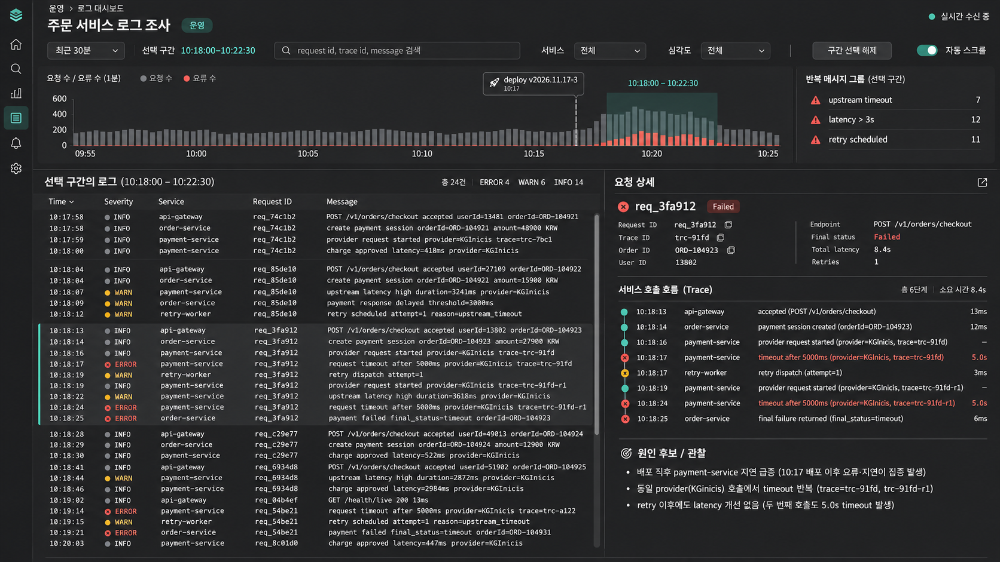

# 주문 서비스 로그 조사 대시보드

세 번째 레퍼런스 묶음이다. 식별자는 `service-logs`, 버전은 `1`이며 2026-11-17에 등록했다. 색감과 간격을 수정한 데스크톱 화면 한 장을 우선 보관한다.

- 화면 ID: `investigation-selected-request`
- 원본: [investigation-selected-request.png](investigation-selected-request.png)
- 파일 정보와 선택 상태: [manifest.json](manifest.json)
- 생성 및 수정 요청: [prompts.md](prompts.md)

## 사용자 선택과 남은 불만족

첫 결과에 대한 사용자 평가는 `색감, 간격: ai-slop`이었다. 에이전트는 반복되는 색상 배지와 선택 영역의 발광, 구분선과 좁은 간격을 원인 후보로 보고 수정 프롬프트를 제공했다. 이 원인 설명은 사용자 발언과 구분한다.

수정 결과에 사용자는 다음과 같이 등록을 요청했다.

> 100% 만족은 아니지만 일단 등록해주세요.

등록 대상으로 선택한 사실은 확인했지만 완전한 만족이나 최종 디자인 승인은 아니다. `selected_by_user: true`는 보관 대상으로 선택했다는 뜻이며, `selection.satisfaction: provisional`과 사용자 발언을 함께 읽는다. 남은 불만족의 구체적인 요소는 아직 확인하지 않았다. 첫 결과는 이 버전의 등록 이미지에 포함하지 않는다.

## 화면 관찰

다음은 에이전트의 관찰이며 사용자가 확정한 취향 규칙이 아니다.

- 상단의 시간 분포와 선택 구간, 왼쪽 로그 목록, 오른쪽 요청 상세를 함께 볼 수 있다.
- 첫 결과보다 배경의 푸른 기운과 색상 배지, 선택 묶음을 감싼 밝은 테두리가 줄었다.
- 선택된 요청은 중성 바탕과 왼쪽 청록색 선으로 표시한다. 오류와 경고는 색상과 상태 글자로 구별한다.
- 많은 로그 행이 여전히 한 화면에 보인다. 간격 수정 요청이 충분히 반영됐거나 밀도 문제가 해결됐다고 판정하지 않는다.

## 보관과 검증 범위

사용자가 제공한 PNG를 변환 없이 복사했다. 원본 파일명, 크기와 SHA-256은 manifest에 기록했다. 대화에서 제공한 프롬프트와 실제 제출한 입력 전문은 구분하며, 생성 모델과 설정 및 비용은 미확인이다.

화면 속 로그 데이터의 정확성, 실제 조작과 접근성 및 구현 품질은 미검증이다. 보관 상태를 좋은 디자인의 확정 사례로 전달하지 않는다. 이미지 전달 검사는 [검증 기록](../../../docs/verification.md)에 별도로 남긴다. 이후 시안은 이 버전을 교체하지 않고 새 버전으로 보관한다.

[레퍼런스 목록](../../README.md)

이전 묶음 ID `logs-003`와 이전 이미지 ID도 MCP에서 계속 조회할 수 있다. 현재 폴더명과 ID의 대응은 [레퍼런스 목록](../../README.md)에 있다.
